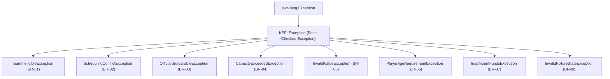

# Kingston Premier Football League (KPFL) & Match-Day Management System
## Technical Architecture & Implementation Report

---

## 1. System Overview & Architectural Objectives
The Kingston Premier Football League (KPFL) and Match-Day Management System is an enterprise-grade Object-Oriented software solution developed in **Java** (SE 17+) and packaged for the **Eclipse IDE**. The system fulfills the operational, administrative, and financial demands of football league governance within the parish of Kingston, Jamaica.

### Core Architecture Pillars:
1. **Object-Oriented Integrity:** Full realization of Abstraction, Encapsulation, Polymorphism, and Multi-Level Inheritance.
2. **Defensive Domain Engineering:** Custom exception hierarchies preventing unlawful league states.
3. **Financial Compliance:** Strict accounting of subtotal, 15% General Consumption Tax (GCT), cash tender validation, and itemized receipt generation.
4. **Persistent File I/O:** Sequential access text file storage resilient to formatting corruption.
5. **Regulatory Analytics:** Automated generation of multi-metric league standings, match-day financial audits, and regulatory compliance reports with CSV export capabilities.

---

## 2. Object-Oriented Design & Principles Applied

### 2.1 Abstraction
Abstraction eliminates redundancy and provides rigid behavioral contracts:
* **`Person` (Abstract Class):** Encapsulates core personal identity (`id`, `name`, `age`, `gender`) and declares the abstract method `public abstract String getDetails()`. Concrete instantiations are prevented.
* **`Product` (Abstract Class):** Models shop inventory items (`productId`, `name`, `unitPrice`, `stockQuantity`) and declares `public abstract String getProductSummary()`. Enforces uniform pricing formulas (`calculateSubtotal`, `calculateGCT`, `calculateTotalWithTax`).

### 2.2 Inheritance
The system implements two distinct class hierarchies:
1. **Personnel Hierarchy:**
   * `Person` $\rightarrow$ `Player` (adds `jerseyNumber`, `position`, `goalsScored`, `playingStatus`)
   * `Person` $\rightarrow$ `Coach` (adds `qualification`, `coachingRole`, `teamAssignment`)
   * `Person` $\rightarrow$ `MatchOfficial` (adds `officiatingRole`, `rank`, `isAvailable`)
   * `Person` $\rightarrow$ `LeagueCommissioner` (adds `accreditationCode`)
   * `Person` $\rightarrow$ `Spectator` (adds `seatCategoryPreference`)
2. **Shop Merchandise Hierarchy:**
   * `Product` $\rightarrow$ `Merchandise` (adds `size`, `category`)
   * `Product` $\rightarrow$ `FoodItem` (adds `expirationDate`, `isVegetarian`)

### 2.3 Polymorphism
Dynamic method dispatch is utilized throughout the system:
* In `Person.getDetails()`, calling `getDetails()` on a collection of `Person` references dynamically executes the specific formatting logic of a `Player`, `Coach`, or `MatchOfficial`.
* In `Product.getProductSummary()`, diverse catalog items are displayed uniformly while revealing subclass-specific details (e.g., sizes for jerseys vs. expiration dates for meat patties).

### 2.4 Encapsulation & Data Validation
All entity attributes maintain `private` or `protected` visibility. Access is regulated via accessors and mutators that validate arguments defensively:
* Player ages are verified against `MINIMUM_LEAGUE_AGE` (16 years).
* Jersey numbers must be integers between 1 and 99 with uniqueness enforced per squad.
* All financial figures, quantities, and match scores are validated as non-negative numbers.

### 2.5 Object Relationships (Aggregation vs. Composition)
* **Aggregation (`FootballTeam` $\diamond$-- `Player`):** Players exist independently of clubs. When a club disbands, player objects remain intact and can transfer.
* **Composition (`FootballLeague` $\blacklozenge$-- `FootballTeam`):** League administration strictly bounds club charters.
* **Composition (`Fixture` $\blacklozenge$-- `MatchResult`):** A match result has no standalone existence outside of the fixture in which it was contested.
* **Composition (`Stadium` $\blacklozenge$-- `StadiumShop`):** The concession shop is an integral physical component of the stadium venue.
* **Association (`Fixture` $\rightarrow$ `FootballTeam` / `Stadium` / `MatchOfficial`):** Fixtures reference clubs and referees to coordinate events without taking ownership of their lifecycles.

---

## 3. Mandatory Business Rules & Custom Exception Design

| Rule ID | Constraint Description | Enforcing Exception | Architectural Layer |
|---|---|---|---|
| **BR-01** | Unregistered or suspended teams cannot be scheduled. | `TeamIneligibleException` | `FixtureService` / `Fixture` |
| **BR-02** | Team cannot participate in two fixtures at same day/time. | `SchedulingConflictException` | `FootballLeague.scheduleFixture()` |
| **BR-03** | Match official cannot be assigned to conflicting fixtures. | `OfficialUnavailableException` | `Fixture.assignOfficial()` |
| **BR-04** | Ticket sales cannot exceed stadium seating capacity. | `CapacityExceededException` | `Stadium.allocateTickets()` |
| **BR-05** | Match scores, stock quantities, and prices cannot be negative. | `InvalidValueException` | Model Constructors & Mutators |
| **BR-06** | Players must satisfy league minimum-age requirement ($\ge 16$). | `PlayerAgeRequirementException` | `Player` / `FootballTeam.addPlayer()` |
| **BR-07** | A sale cannot complete if payment tendered is insufficient. | `InsufficientFundsException` | `StadiumShop.processSale()` |
| **BR-08** | Fixture cannot be marked completed without valid score. | `InvalidFixtureStateException` | `Fixture.recordResultAndComplete()` |

---

## 4. Financial Calculations & GCT Accounting

Match-day financial accounting adheres to the Jamaican General Consumption Tax (GCT) statutory rate:

$$\text{Subtotal} = \sum_{i=1}^{n} (\text{UnitPrice}_i \times \text{Quantity}_i)$$
$$\text{GCT} = \text{Subtotal} \times 0.15$$
$$\text{Grand Total} = \text{Subtotal} + \text{GCT}$$
$$\text{Change} = \text{AmountTendered} - \text{Grand Total}$$

If $\text{AmountTendered} < \text{Grand Total}$, the transaction aborts and throws `InsufficientFundsException`. When approved, stock levels decrease and an itemized receipt is generated.

---

## 5. Persistence Subsystem Design

Data persistence utilizes sequential text files with pipe (`|`) delimiters. This ensures:
1. Instant human inspection during academic defense and grading.
2. Resilience against delimiter collisions with club names or descriptions.
3. Fault-tolerant loading: corrupted individual records log warnings rather than crashing the system.

### File Schema Matrix
* `teams.txt`: `RegistrationNumber|Name|Parish|SquadSize|Status|MatchesPlayed|Wins|Draws|Losses|GoalsFor|GoalsAgainst|Points`
* `players.txt`: `PersonId|Name|Age|Gender|TeamRegNo|Position|JerseyNumber|GoalsScored|PlayingStatus`
* `stadiums.txt`: `StadiumId|Name|Location|SeatingCapacity|TicketsSold|FieldCondition|BaseTicketPrice`
* `fixtures.txt`: `FixtureId|HomeTeamRegNo|AwayTeamRegNo|StadiumId|Date|Time|Status|HomeScore|AwayScore`
* `products.txt`: `ProductId|Type|Name|Price|Stock|Detail1|Detail2`

---

## 6. Management Reports & Optional Extensions

The system generates three structured analytical management reports:
1. **KPFL Official Standings Table:** Standard competition ranking (Win = 3, Draw = 1, Loss = 0) with tie-breakers on Goal Difference and Goals For.
2. **Match-Day Financial & Attendance Audit:** Venue occupancy percentages, ticket sales, 15% GCT breakdown, and concession performance.
3. **Regulatory Compliance Audit:** Roster age compliance, coaching qualifications, and official availability.
* **Optional Extension (Section 15):** The system integrates `CsvExportService`, permitting instant export of all reports into standard CSV files for spreadsheet analytics.
