# KPFL Management System: Week 1 Deliverable
## Part 2: UML Class Diagram & Object-Oriented Design Rationale

---

## 1. Complete UML Class Diagram Specification

The diagram below details all entities, attributes, methods, visibilities (`+` public, `-` private, `#` protected), multiplicities, and relationship types (Inheritance, Realization, Composition, Aggregation, Association).

```mermaid
classDiagram
    %% Abstract Interfaces & Base Classes
    class Reportable {
        <<interface>>
        +generateReport() String
    }
    
    class Persistable {
        <<interface>>
        +toDataRecord() String
        +fromDataRecord(String record) void
    }

    class Person {
        <<abstract>>
        #String id
        #String name
        #int age
        #String gender
        +Person(String id, String name, int age, String gender)
        +getId() String
        +getName() String
        +getAge() int
        +getGender() String
        +setAge(int age) void
        +getDetails()* String
    }

    class Player {
        -String position
        -int jerseyNumber
        -int goalsScored
        -String playingStatus
        +Player(String id, String name, int age, String gender, String position, int jerseyNumber)
        +recordGoal() void
        +getDetails() String
        +toDataRecord() String
    }

    class Coach {
        -String qualification
        -String coachingRole
        -String teamAssignment
        +Coach(String id, String name, int age, String gender, String qualification, String coachingRole)
        +getDetails() String
    }

    class MatchOfficial {
        -String officiatingRole
        -int rank
        -boolean isAvailable
        +MatchOfficial(String id, String name, int age, String gender, String officiatingRole, int rank)
        +setAvailable(boolean available) void
        +getDetails() String
    }

    class LeagueCommissioner {
        -String accreditationCode
        +LeagueCommissioner(String id, String name, int age, String gender, String accreditationCode)
        +approveTeam(FootballTeam team) void
        +getDetails() String
    }

    class Spectator {
        -String preferredCategory
        +Spectator(String id, String name, int age, String gender, String preferredCategory)
        +getDetails() String
    }

    %% Inheritance for Person Hierarchy
    Person <|-- Player
    Person <|-- Coach
    Person <|-- MatchOfficial
    Person <|-- LeagueCommissioner
    Person <|-- Spectator
    Person ..|> Persistable

    %% Product Hierarchy
    class Product {
        <<abstract>>
        #String productId
        #String name
        #double unitPrice
        #int stockQuantity
        +Product(String id, String name, double price, int stock)
        +getProductId() String
        +getName() String
        +getUnitPrice() double
        +getStockQuantity() int
        +reduceStock(int qty) void
        +calculateTotal(int qty) double
        +getProductSummary()* String
    }

    class Merchandise {
        -String size
        -String category
        +Merchandise(String id, String name, double price, int stock, String size, String category)
        +getProductSummary() String
    }

    class FoodItem {
        -String expirationDate
        -boolean isVegetarian
        +FoodItem(String id, String name, double price, int stock, String expirationDate, boolean isVegetarian)
        +getProductSummary() String
    }

    Product <|-- Merchandise
    Product <|-- FoodItem
    Product ..|> Persistable

    %% Core League Entities
    class FootballLeague {
        -String leagueName
        -String season
        -List~FootballTeam~ teams
        -List~Stadium~ stadiums
        -List~Fixture~ fixtures
        -List~MatchOfficial~ officials
        -LeagueCommissioner commissioner
        +registerTeam(FootballTeam team) void
        +scheduleFixture(Fixture fixture) void
        +generateStandings() List~FootballTeam~
    }

    class FootballTeam {
        -String registrationNumber
        -String name
        -String parish
        -int squadSize
        -String leagueStatus
        -int matchesPlayed
        -int wins
        -int draws
        -int losses
        -int goalsFor
        -int goalsAgainst
        -int points
        -List~Player~ players
        -Coach headCoach
        +addPlayer(Player player) void
        +recordMatchOutcome(int gf, int ga) void
        +getGoalDifference() int
    }

    class Stadium {
        -String stadiumId
        -String name
        -String location
        -int seatingCapacity
        -int ticketsSold
        -String fieldCondition
        -double baseTicketPrice
        -StadiumShop stadiumShop
        +hasAvailableCapacity(int quantity) boolean
        +allocateTickets(int quantity) void
    }

    class Fixture {
        -String fixtureId
        -FootballTeam homeTeam
        -FootballTeam awayTeam
        -Stadium venue
        -LocalDate matchDate
        -LocalTime matchTime
        -String status
        -List~MatchOfficial~ assignedOfficials
        -MatchResult matchResult
        +assignOfficial(MatchOfficial official) void
        +completeFixture(int homeGoals, int awayGoals) void
    }

    class MatchResult {
        -int homeScore
        -int awayScore
        -String outcome
        -LocalDateTime recordedAt
        +getHomeScore() int
        +getAwayScore() int
        +getOutcome() String
    }

    class Ticket {
        -String ticketId
        -String fixtureId
        -String category
        -double basePrice
        -double taxAmount
        -double totalPrice
    }

    class StadiumShop {
        -String shopId
        -List~Product~ inventory
        -List~SaleTransaction~ transactions
        +addProduct(Product p) void
        +processSale(List~OrderItem~ items, double amountTendered) SaleReceipt
    }

    %% Relationships and Multiplicities
    FootballLeague "1" *-- "0..*" FootballTeam : Composition
    FootballLeague "1" *-- "0..*" Stadium : Composition
    FootballLeague "1" *-- "0..*" Fixture : Composition
    FootballLeague "1" o-- "0..*" MatchOfficial : Aggregation
    FootballLeague "1" o-- "1" LeagueCommissioner : Association

    FootballTeam "1" o-- "0..*" Player : Aggregation
    FootballTeam "1" o-- "0..1" Coach : Aggregation

    Fixture "1" --> "1" FootballTeam : Home Team
    Fixture "1" --> "1" FootballTeam : Away Team
    Fixture "1" --> "1" Stadium : Venue
    Fixture "1" o-- "1..*" MatchOfficial : Aggregation
    Fixture "1" *-- "0..1" MatchResult : Composition

    Stadium "1" *-- "1" StadiumShop : Composition
    Stadium "1" *-- "0..*" Ticket : Composition

    FootballLeague ..|> Reportable
    FootballTeam ..|> Persistable
    Fixture ..|> Persistable
    Stadium ..|> Persistable
```



---

## 2. Object-Oriented Design Decisions & Justification

### 2.1 Inheritance Hierarchies
1. **The `Person` Hierarchy:**
   * **Base Class:** `Person` is modeled as an `abstract class` because the league never interacts with a generic, unspecialized person; individuals always participate as a `Player`, `Coach`, `MatchOfficial`, `LeagueCommissioner`, or `Spectator`.
   * **Polymorphism:** The abstract method `getDetails()` is overridden across all subclasses, allowing polymorphic iteration and display across personnel directories.
   * **Shared State:** Common attributes (`id`, `name`, `age`, `gender`) and their access validation are centralized in `Person`, avoiding code duplication and enforcing consistent validation.

2. **The `Product` Hierarchy:**
   * **Base Class:** `Product` is an `abstract class` modeling merchandise and concessions sold at match-day venues.
   * **Polymorphism:** Subclasses `Merchandise` (clothing, accessories) and `FoodItem` (beverages, snacks) implement `getProductSummary()` with specialized attributes (sizes vs. expiration dates). Method `calculateTotal(qty)` provides a uniform pricing contract.

### 2.2 Aggregation vs. Composition Rationale
* **`FootballTeam` and `Player` (Aggregation):**
  * *Relationship:* A Team consists of Players (`1 o-- 0..*`).
  * *Justification:* A player is an independent person whose life cycle is not tied exclusively to one club. If a team withdraws from the KPFL or a player transfers, the `Player` object remains valid and can be re-assigned.
* **`FootballTeam` and `Coach` (Aggregation):**
  * *Relationship:* A Team employs a Coach (`1 o-- 0..1`).
  * *Justification:* Coaches can switch teams or be unassigned without being destroyed.
* **`Fixture` and `MatchResult` (Composition):**
  * *Relationship:* A Fixture owns its `MatchResult` (`1 *-- 0..1`).
  * *Justification:* A match result cannot exist without the specific fixture in which it occurred. If a fixture is purged from history, its associated score sheet has no independent context and is deleted with it.
* **`Stadium` and `StadiumShop` (Composition):**
  * *Relationship:* A Stadium contains a Stadium Shop (`1 *-- 1`).
  * *Justification:* The stadium shop is a physical match-day concession facility built directly into that stadium venue.
* **`Fixture` and `FootballTeam` / `Stadium` / `MatchOfficial` (Association & Aggregation):**
  * *Relationship:* The Fixture references two teams, one stadium, and multiple officials.
  * *Justification:* Fixtures act as coordinating events linking clubs and referees without owning their lifecycles.

---

## 3. User Interface Design: Console Menu Hierarchy

A text-based menu system provides clear, numbered navigation that exercises all required business operations:

```
=============================================================
  KINGSTON PREMIER FOOTBALL LEAGUE (KPFL) MANAGEMENT SYSTEM
=============================================================
1. Teams & Personnel Management
   1.1 Register New Football Team
   1.2 Add / Update Player on Team Roster
   1.3 Assign / Update Head Coach
   1.4 View Team Squad & Player Details
   1.5 Search Teams by Parish / Registration Number

2. Stadium & Venue Operations
   2.1 Register New Stadium
   2.2 Update Seating Capacity & Field Condition
   2.3 View All Stadiums & Availability

3. Fixture Scheduling & Match Operations
   3.1 Schedule New Fixture (with Conflict Validation)
   3.2 Assign Match Officials to Fixture
   3.3 Record Match Scores & Finalize Fixture
   3.4 View Upcoming and Completed Fixtures

4. Match-Day Services (Ticketing & Shop)
   4.1 Sell Match Tickets (with Capacity Checking & 15% GCT)
   4.2 Stadium Shop: View Product Inventory
   4.3 Stadium Shop: Process Sale & Print Receipt (with GCT)

5. Reports & Analytics
   5.1 Generate Official KPFL Standings Table
   5.2 Generate Match-Day Financial & Revenue Summary
   5.3 Generate Team & Official Compliance Audit Report

6. Persistence & System Settings
   6.1 Save All System Data to Files
   6.2 Reload System Data from Files
   6.3 System Diagnostics & Reset
0. Exit Application
=============================================================
```
